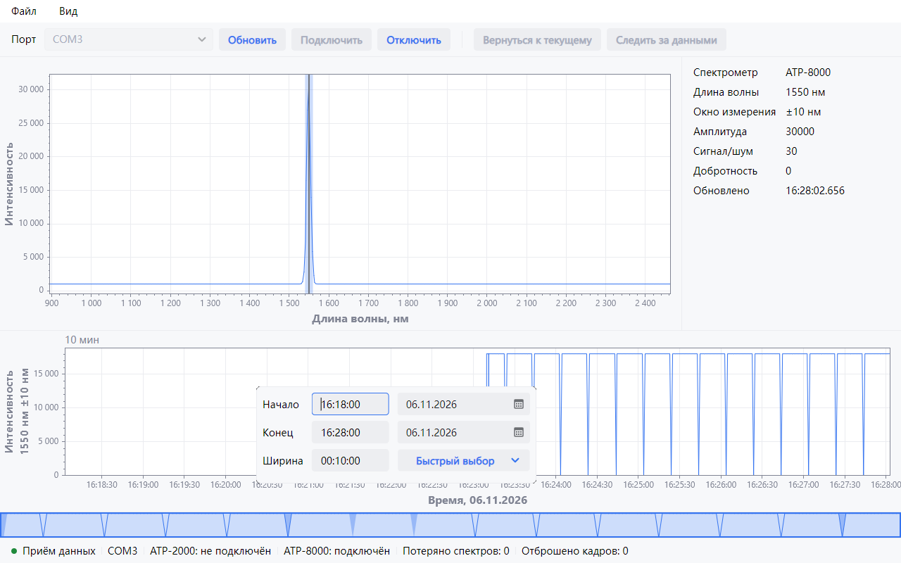
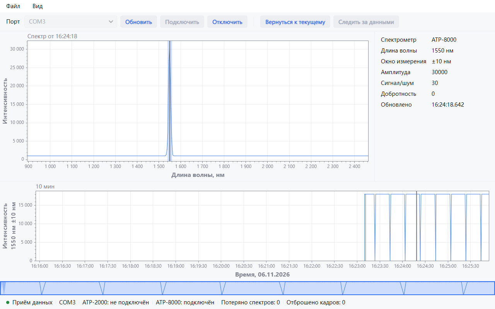
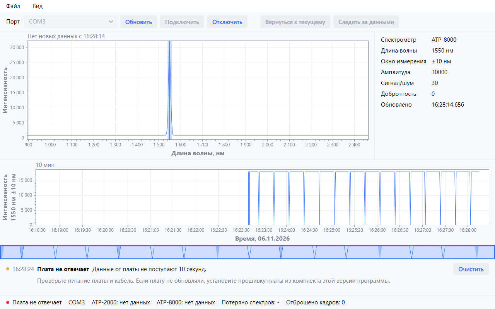

# SemiSpec

    

SemiSpec показывает спектр с платы спектрометров ATP-2000 и ATP-8000 и тренд интенсивности на длине волны,
которую задаёт SCADA. Программа читает плату через COM-порт и хранит спектры за последние 24 часа.

    
    
<em>Главное окно: спектр, значения платы, тренд, обзор истории и панель интервала времени</em>

## Возможности

- Спектр с окном измерения ±`delta` и значения платы: амплитуда, сигнал/шум, добротность.
- Тренд интенсивности за 24 часа с разрывами на потерянных спектрах и полосой ошибок измерения. Полоса обзора под
  трендом показывает всю историю.
- Щелчок по тренду открывает спектр этого момента.
- Щелчок по оси открывает панель шкалы: границы, логарифмическая шкала, отсчёт от нуля, интервал времени.
- Строка состояния и панель сообщений называют неполадку связи и что сделать.

    
    
<em>Спектр прошлого момента</em>

    
    
<em>Плата не отвечает</em>

## Требования

| Компонент            | Требование                              |
| -------------------- | --------------------------------------- |
| Операционная система | Windows 10 или Windows 11, 64-разрядная |

## Установка

Установщик `SemiSpecInstaller.exe` находится на странице
[Releases](https://github.com/Semiteq/SemiSpec/releases/latest).

Журнал программы лежит в папке `%LOCALAPPDATA%\SemiSpec\Logs`.
