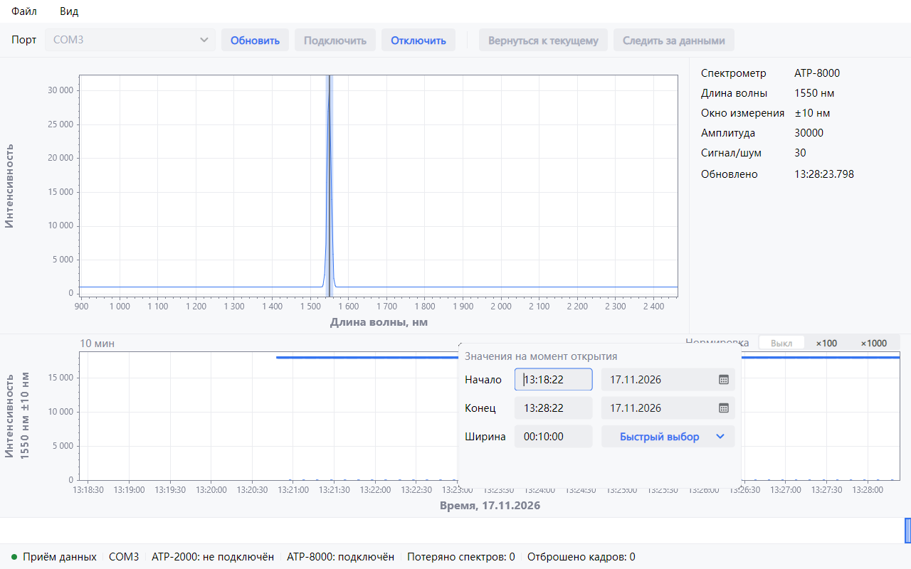
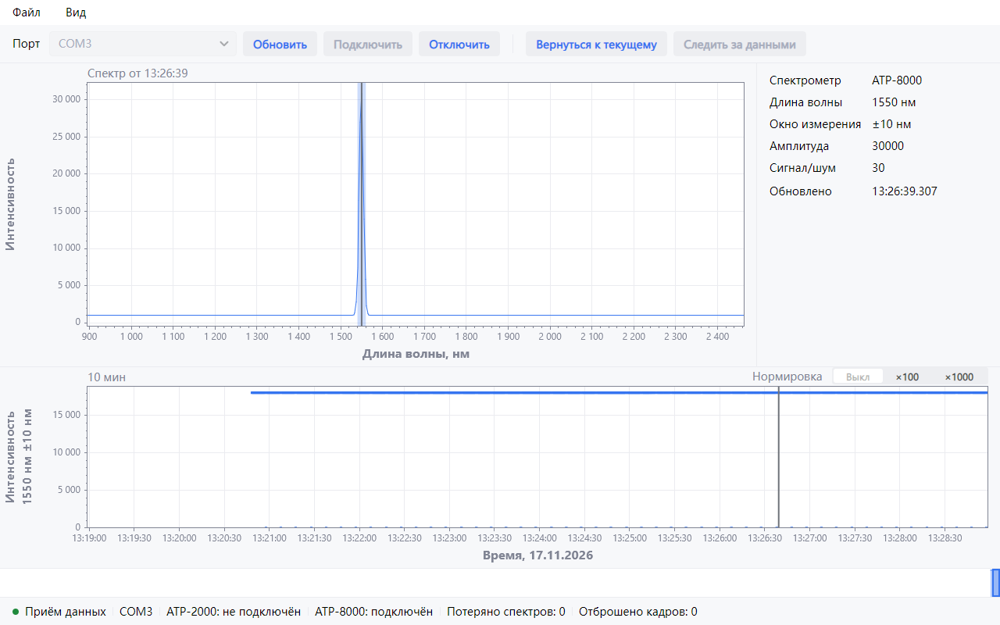
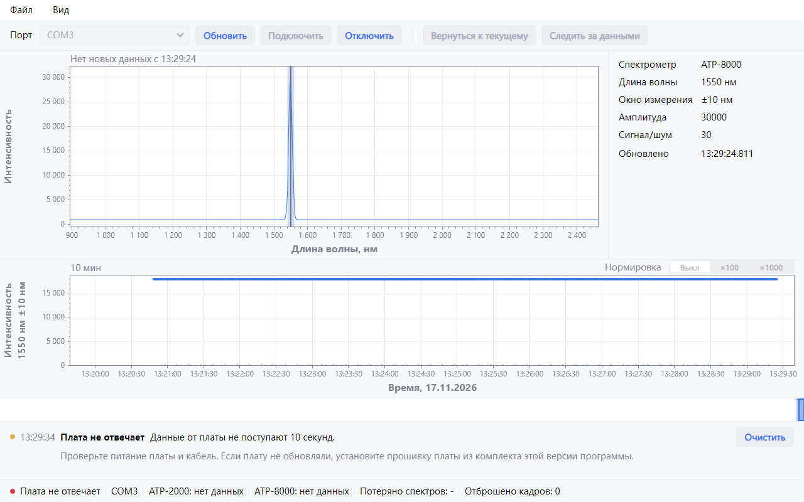

# SemiSpec

    

SemiSpec показывает спектр с платы спектрометров ATP-2000 и ATP-8000 и тренд интенсивности на длине волны,
которую задаёт SCADA. Программа читает плату через COM-порт.

    
    
<em>Главное окно: спектр, значения платы, тренд, обзор истории и панель интервала времени</em>

## Возможности

### Спектр и тренд

- Верхний график показывает последний спектр и окно измерения вокруг длины волны, которую задаёт SCADA. Справа
  значения платы: спектрометр, длина волны, окно измерения, амплитуда, сигнал/шум и время обновления. Пункт
  «Вид → Добротность» добавляет к ним добротность.
- Нижний график показывает тренд интенсивности в этом окне за 24 часа точками: наименьшее и наибольшее значение за
  каждый пиксель времени. Пункт «Вид → Тренд линиями» соединяет их линией. Там, где спектров не было, тренд
  прерывается, красная полоса отмечает ошибки измерения. Полоса обзора под трендом показывает всю историю, щелчок
  по ней переносит тренд в это место.
- Переключатель «Нормировка» над трендом: «Выкл», «×100», «×1000». Нажатие «×100» или «×1000» запоминает текущий
  спектр в окне измерения. Дальше каждый пиксель окна делится на свой запомненный пиксель, результаты
  усредняются и умножаются на 100 или 1000. История до нажатия пересчитывается так же. Нажимайте, пока образец
  стабилен: запоминается один спектр. «Выкл» выключает нормировку, смена длины волны или окна измерения
  выключает её сама. После перезапуска программы нормировка выключена.
- Щелчок по тренду показывает спектр этого момента, кнопка «Вернуться к текущему» возвращает последний.
- Щелчок по оси открывает её настройки: границы, логарифмическая шкала, «От нуля», интервал времени. Кнопка
  «Следить за данными» возвращает тренд к текущему времени.

    
    
<em>Спектр прошлого момента</em>

### Связь с платой

- Строка состояния внизу окна показывает связь с платой, состояние каждого спектрометра и число потерянных спектров.
  Если порт пропал, программа открывает его заново каждую секунду.
- Панель сообщений называет неполадку и что сделать. Пункт «Вид → Панель сообщений» скрывает и показывает её.

    
    
<em>Плата не отвечает</em>

### Запуск и история

- Программа хранит спектры за 24 часа, история сохраняется между запусками.
- Запускается одна копия программы, повторный запуск выводит открытое окно на передний план.

## Требования

| Компонент            | Требование                              |
| -------------------- | --------------------------------------- |
| Операционная система | Windows 10 или Windows 11, 64-разрядная |

## Установка

Установщик `SemiSpecInstaller.exe` находится на странице
[Releases](https://github.com/Semiteq/SemiSpec/releases/latest).

Журнал программы лежит в папке `C:\DISTR\Logs\SemiSpec`, файл `semispec.log`. Выбор в меню «Вид» программа
запоминает в файле `C:\DISTR\Config\SemiSpec\settings.yaml`.
